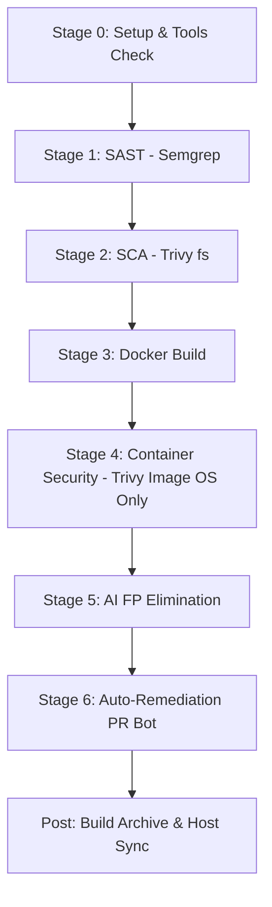

# 🛡️ Mini DevSecOps Lab & AI FP Eliminator

Bu repo, tamamen **ücretsiz ve açık kaynaklı** araçlardan oluşan, tek bir bundle (`docker compose`) halinde çalışan uçtan uca bir DevSecOps lab ortamıdır.

Pipeline boyunca **SAST**, **SCA** ve **Container Security** adımları işletilir, üretilen bulgular üzerinden **AI Destekli False Positive (FP) Eliminasyonu** gerçekleştirilir, tespit edilen bağımlılık açıkları için **Otomatik Düzeltme PR'ı (Fixed PR)** açılır ve tüm süreç **React Dashboard** üzerinden build bazlı olarak takip edilir.

---

## 🏗️ Mimari & Kullanılan Teknolojiler

```text
devsecops-labs/
├── docker-compose.yml          # Jenkins, Dashboard & Zafiyetli Hedef Uygulama
├── jenkins/
│   ├── Dockerfile              # Docker CLI, Trivy, Semgrep, Python3 hazır imaj
│   ├── casc.yaml               # Zero-touch Jenkins kurulumu (admin:admin + hazır pipeline)
│   └── plugins.txt             # Gerekli Jenkins pluginleri
├── dashboard/                  # [React + Express] DevSecOps Dashboard (Port 3001)
│   ├── src/                    # KPI Cards, Build Selector, SAST & AI, SCA, Container sekmeleri
│   ├── components/             # CodeInspectorModal (Zafiyetli Pattern & Sink Denetçisi)
│   ├── server.js               # Dinamik rapor & Build geçmişi API'si
│   └── Dockerfile              # Çok aşamalı Vite build + Express runtime
├── sample-app/                 # Hedef Zafiyetli Node.js Uygulaması (Port 3000)
│   ├── server.js               # SQLi, Cmd Injection, XSS, Path Traversal + Bilinçli FP'ler
│   ├── package.json            # Zafiyetli npm bağımlılıkları (Lodash, Axios, JWT, EJS vb.)
│   ├── package-lock.json       # Trivy SCA için bağımlılık kilit dosyası
│   └── Dockerfile              # Güvenlik açıkları olan Alpine taban imajı
├── scripts/
│   └── remediation_bot.py      # [Yeni] Otomatik Fixed PR Oluşturucu Bot
├── Jenkinsfile                 # Uçtan uca DevSecOps Pipeline kodu
├── ai-engine/                  # [Faz 2] AI Tabanlı FP Eliminasyon Motoru
│   ├── analyzer.py             # Semgrep JSON çıktısını kod bağlamıyla analiz eden motor
│   ├── prompts.py              # AppSec odaklı LLM Prompt şablonları
│   └── requirements.txt
└── reports/                    # Pipeline tarama çıktılarının (JSON) üretildiği dizin
    └── builds/                 # Build bazlı geçmiş raporlar (Build #5, #6...)
```

### 🌐 Canlı Servisler ve Port Haritası

| Servis | URL / Port | Kimlik Bilgileri | Açıklama |
| :--- | :--- | :--- | :--- |
| **DevSecOps Dashboard** | **[http://localhost:3001](http://localhost:3001)** | - | Zafiyetler, Build geçmişi & AI Triage paneli |
| **Jenkins CI/CD** | **[http://localhost:8080](http://localhost:8080)** | `admin` / `admin` | Güvenlik pipeline orkestrasyonu |
| **Vulnerable Target App** | **[http://localhost:3000](http://localhost:3000)** | - | Zafiyetli hedef mikro servis (AI Pentester hedefi) |

---

## 🚀 Hızlı Başlangıç (Tek Komut)

### 1. Docker Desktop'ın Çalıştığından Emin Olun
macOS üzerinde Docker Desktop uygulamasını başlatın.

### 2. Ortamı Ayağa Kaldırın
Terminalden proje dizinine gelip şu komutu çalıştırın:

```bash
docker compose up -d --build
```

Bu komut:
1. Docker CLI, Trivy ve Semgrep araçlarını içeren özel Jenkins imajını derler.
2. React tabanlı güvenlik dashboard'unu (`port 3001`) derler ve ayağa kaldırır.
3. Zafiyetli hedef uygulamayı (`port 3000`) bağımsız bir konteyner olarak başlatır.
4. Jenkins Configuration as Code (JCasC) ile `admin:admin` kullanıcısını ve **`DevSecOps-Security-Pipeline`** işini hazır olarak oluşturur.

---

## 🧪 Pipeline Aşamaları

Pipeline çalıştığında sırasıyla şu adımlar işletilir:



1. **SAST (Semgrep):** Kaynak kod analizi yapar, zafiyetin patladığı kesin satırı (`Sink`) ve kod bağlamını yakalar.
2. **SCA (Trivy `fs`):** `package-lock.json` üzerinden kütüphane CVE'lerini tespit eder.
3. **Build:** Zafiyetli uygulamanın Docker imajını derler.
4. **Container Security (Trivy `image`):** `--pkg-types os` filtresiyle SCA ile duplicate oluşturmadan **sadece Alpine Linux işletim sistemi açıklarını** (`busybox`, `libcrypto`, `zlib`) tarar.
5. **AI Triage (FP Eliminator):** Semgrep bulgularını analiz ederek sanitizasyondan geçmiş (XSS korumalı, whitelist korumalı, mock token) yanlış alarmları eler.
6. **Auto-Remediation PR Bot:** Zafiyetli paketlerin sürümlerini `package.json` içinde günceller, `fix/security-remediation-sca` dalını açar ve GitHub'a **Pull Request** gönderir.
7. **Post Actions:** Raporları `reports/builds/${BUILD_NUMBER}/` altında kalıcı olarak arşivler.

---

## 🤖 Otomatik İyileştirme Botu (Remediation PR Bot)

Geliştiricilerin zafiyetleri tek tek elle düzeltmek zorunda kalmaması için `scripts/remediation_bot.py` modülü geliştirilmiştir:

* **Çalışma Prensibi:**
  1. `reports/trivy-sca-results.json` çıktısını okur.
  2. Zafiyet tespit edilen paketlerin (`axios`, `lodash`, `moment`, `jsonwebtoken`, `ejs`) güvenli hedef sürümlerini hesaplar.
  3. `package.json` dosyasındaki sürümleri otomatik yükseltir.
  4. Yeni bir git dalı oluşturur: `fix/security-remediation-sca`.
  5. `package-lock.json` dosyasını günceller ve commit atar.
  6. Dalı GitHub'a (`origin`) push eder ve PR açar:
     * `GITHUB_TOKEN` tanımlıysa doğrudan GitHub API üzerinden PR'ı otomatik açar.
     * Token tanımlı değilse tek tıkla açılabilecek [Compare & PR Linki](https://github.com/cnkgkce/devsecops-labs/compare/main...fix/security-remediation-sca?expand=1) üretir.
* **Geliştirici Deneyimi:** Geliştirici sadece tek bir PR'ı onaylayıp `Merge` ederek tek seferde onlarca CVE'yi kapatabilir.

---

## 📊 Build Bazlı Raporlama ve Trend Karşılaştırması

Dashboard üzerinde build geçmişi takip edilebilir:

* **Build Seçici:** Dashboard üst menüsünden `Build #5`, `Build #6` gibi geçmiş veya en son çalışan build seçilebilir.
* **Build Karşılaştırma Bandı (Diff Banner):**
  * Önceki build ile aktif build arasındaki farkı hesaplar.
  * Örneğin Remediation PR'ı merge edildikten sonra tetiklenen yeni build'de:  
    `🎉 19 Zafiyet Giderildi! (25 ➔ 6)` şeklinde yeşil başarı göstergesi sunulur.
* **Drill-down Aksiyon Listesi:** Kütüphane bazında gruplanmış aksiyon kartları üzerinden tek bir paket güncellemesinin kaç CVE'yi çözeceği görüntülenebilir.

---

## 🎯 Bağımsız Zafiyetli Hedef Uygulama (`http://localhost:3000`)

Kasıtlı olarak zafiyet barındıran mikro servis, bağımsız bir servis olarak ayağa kalkar:

* **Endpoint'ler:**
  * `GET /api/ping?host=127.0.0.1` ➔ **Command Injection**
  * `GET /api/users?username=admin` ➔ **SQL Injection**
  * `GET /api/greet?name=Team` ➔ **Reflected XSS**
  * `GET /api/view-log?file=app.log` ➔ **Path Traversal**
  * `GET /api/system-status?service=nginx` ➔ **Güvenli Whitelist (False Positive Hedefi)**
  * `GET /api/safe-greet?user=Alice` ➔ **Sanitize Edilmiş HTML (False Positive Hedefi)**

### 🔮 Gelecek Faz: AI Pentester Entegrasyonu
Bu uygulama ilerleyen aşamada bir **AI Pentester (Otonom Sızma Testi Ajanı)** için hedef teşkil edecektir. AI Pentester'a pipeline'ın ürettiği SAST, SCA ve Container raporları önden verilerek bir **Whitebox AI Saldırı Laboratuvarı** kurgulanacaktır.
