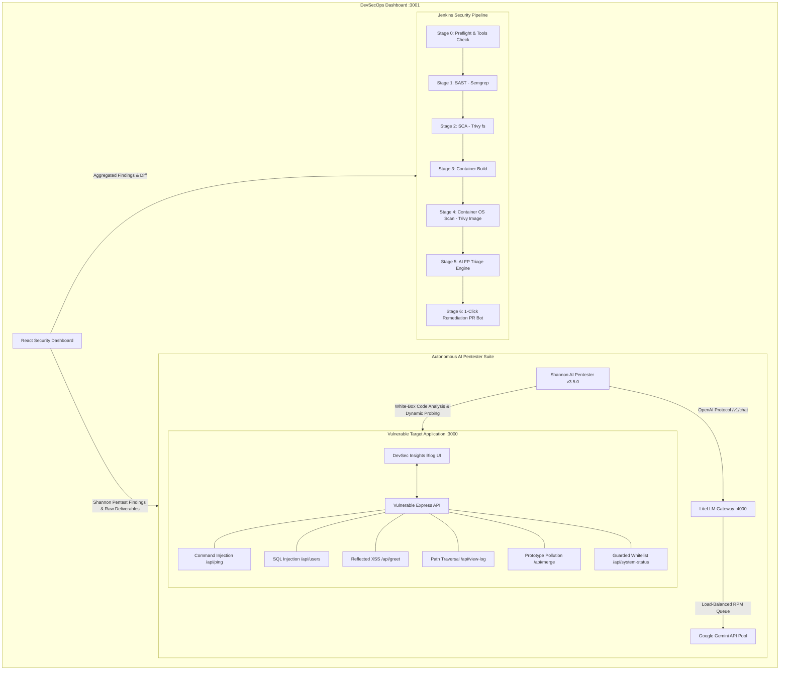

# 🛡️ DevSecOps Security Automation & Autonomous AI Pentester Lab

[](https://www.docker.com/)
[](https://www.jenkins.io/)
[](https://trivy.dev/)
[](https://semgrep.dev/)
[](https://litellm.ai/)
[](https://ai.google.dev/)
[](https://github.com/KeygraphHQ/shannon)

A fully containerized, production-grade **DevSecOps Lab** and **Autonomous AI Penetration Testing Sandbox**. This laboratory provides an end-to-end security pipeline incorporating **SAST**, **SCA**, **Container Security**, **LLM-driven False Positive (FP) Triage**, **1-Click Auto-Remediation PRs**, and a live **Autonomous AI Pentester (Shannon)** powered by **Google Gemini** via a **LiteLLM Gateway**.

---

## 🏗️ Architecture & Component Overview



### 🌐 Live Service & Port Matrix

| Service | Address / Port | Credentials | Description |
| :--- | :--- | :--- | :--- |
| **DevSecOps Dashboard** | **[http://localhost:3001](http://localhost:3001)** | *None* | Centralized UI for SAST, SCA, Container, AI Triage, and **Shannon AI Pentest** results. |
| **Target Blog Application** | **[http://localhost:3000](http://localhost:3000)** | `admin` / `admin123`<br>`john_doe` / `user123` | **"DevSec Insights"** tech blog with interactive vulnerability testbeds & JWT authentication. |
| **Jenkins CI/CD Orchestrator** | **[http://localhost:8080](http://localhost:8080)** | `admin` / `admin` | Automated security pipeline with JCasC (Jenkins Configuration as Code). |
| **LiteLLM Model Gateway** | **[http://localhost:4000](http://localhost:4000)** | `sk-devsecops-litellm-123456` | OpenAI/Anthropic to Google Gemini API proxy with load balancing and rate limiting. |

---

## 🎯 Target Web Application: "DevSec Insights"

The vulnerable application (`sample-app`, running on port **3000**) is modeled as a modern engineering and cloud security blog. It serves a responsive HTML5/CSS3 frontend while exposing intentionally vulnerable and guarded endpoints:

### Vulnerability & Exploit Matrix

| Endpoint | HTTP Method | Vulnerability Type | Code Sink Location | Exploit PoC Payload |
| :--- | :---: | :--- | :--- | :--- |
| `/api/ping` | `GET` | **Command Injection** | `server.js:33` (`exec`) | `?host=127.0.0.1; whoami` |
| `/api/users` | `GET` | **SQL Injection** | `server.js:44` (`mockDatabase.query`) | `?username=admin' OR '1'='1` |
| `/api/greet` | `GET` | **Reflected XSS** | `server.js:56` (Direct reflection) | `?name=<script>alert('XSS')</script>` |
| `/api/view-log` | `GET` | **Path Traversal / LFI** | `server.js:62` (`fs.readFileSync`) | `?file=../../../../etc/passwd` |
| `/api/merge` | `POST` | **Prototype Pollution** | `server.js:73` (`lodash.merge`) | `{"__proto__": {"polluted": true}}` |
| `/api/login` | `POST` | **Hardcoded Secret Signing**| `server.js:134` (`jwt.sign`) | Exploits leaked `JWT_SECRET` |
| `/api/system-status`| `GET` | **Guarded / Safe Whitelist**| `server.js:93` (Strict array check) | `?service=nginx` (Verified immune) |

---

## 🤖 Shannon AI Pentester & LiteLLM Gateway

The lab integrates [Shannon](https://github.com/KeygraphHQ/shannon), an autonomous AI penetration testing framework that combines AST static source code analysis with live dynamic exploitation.

### LiteLLM Gateway & Gemini Model Pool

Because Shannon natively communicates via the OpenAI (`/v1/chat/completions`) or Anthropic protocols, this lab introduces **LiteLLM** (`port 4000`) in `docker-compose.yml`. LiteLLM transparently proxies requests to **Google Gemini** models using your free Google AI Studio API key.

To prevent Google AI Studio Free Tier rate limits (15 Requests Per Minute per model) from blocking concurrent sub-agents, LiteLLM is configured with a **5-model load-balanced pool**:
- `gemini/gemini-flash-lite-latest`
- `gemini/gemini-3.5-flash`
- `gemini/gemini-3.5-flash-lite`
- `gemini/gemini-3.1-flash-lite`
- `gemini/gemini-3.1-flash-lite-preview`

**Total Aggregate Capacity:** **~75–90 Requests Per Minute (RPM)** with automated backoff retry (`cooldown_time: 20s`, `num_retries: 15`).

### Running an AI Pentest

```bash
# 1. Start an automated scan with live log follow
bash scripts/run_shannon.sh

# 2. Re-run or resume a previous workspace
npx -y @keygraph/shannon start \
  -u http://host.docker.internal:3000 \
  -r ./sample-app \
  -c ./shannon.yaml \
  -w <workspace_name> -f
```

Scan deliverables (`recon_deliverable.md`, `pre_recon_deliverable.md`) are automatically saved to `reports/shannon/` and visualized on the **DevSecOps Dashboard**.

---

## 📊 DevSecOps Dashboard Features (`http://localhost:3001`)

The React-based dashboard provides a command center for security engineers and developers:

1. **AI Pentest (Shannon) View:**
   - Visual cards for all identified vulnerabilities with severity ratings, code sinks, and 1-click PoC copy buttons.
   - Attack Surface & API Inventory table.
   - Verbatim markdown viewer for Shannon's `recon_deliverable.md`.
   - Architectural flow diagram showing the agent mesh.
2. **SAST & AI Triage (Semgrep):**
   - Exact line and sink code inspector modal.
   - AI confidence score eliminating false alarms (e.g. whitelisted command injection).
3. **SCA Dependency Health (Trivy fs):**
   - CVE list for `package-lock.json` packages (`lodash`, `axios`, `jsonwebtoken`, `ejs`, etc.).
   - Actionable grouping displaying how upgrading a single library resolves multiple CVEs.
4. **Container Security (Trivy Image OS):**
   - Scans Alpine base image packages (`busybox`, `libcrypto`, `zlib`) without duplication.
5. **1-Click Auto-Remediation PR Generator:**
   - Triggers `scripts/remediation_bot.py` from the UI to update `package.json`, commit to a fix branch, and generate an automated GitHub Pull Request.

---

## 🚀 Quick Start Guide

### Prerequisites
- **macOS / Linux** with [Docker Desktop](https://www.docker.com/) installed and running.
- A free **Google Gemini API Key** from [Google AI Studio](https://aistudio.google.com/app/apikey).

### 1. Clone & Configure Environment

```bash
git clone https://github.com/cnkgkce/devsecops-labs.git
cd devsecops-labs

# Copy template and add your Gemini API key
cp .env.example .env
```

Edit `.env`:
```ini
GEMINI_API_KEY="AIzaSyYourActualKeyGoesHere"
LITELLM_MASTER_KEY=sk-devsecops-litellm-123456
```
> 🔒 **Security Notice:** `.env` is explicitly declared in `.gitignore` and is never tracked or pushed to remote repositories.

### 2. Boot the Entire Lab Stack

```bash
docker compose up -d --build
```

This launches:
- `devsecops-jenkins` on `http://localhost:8080`
- `devsecops-dashboard` on `http://localhost:3001`
- `devsecops-vulnerable-app` on `http://localhost:3000`
- `devsecops-litellm` on `http://localhost:4000`

### 3. Launch an Autonomous AI Pentest

```bash
bash scripts/run_shannon.sh
```

Inspect the findings either in your terminal or live in the web browser at **[http://localhost:3001](http://localhost:3001)** under the **AI Pentest (Shannon)** tab.

---

## 🔒 Confidentiality & Security Policy

This laboratory is created solely for **educational, DevSecOps training, and AI security research purposes**. All vulnerabilities are sandboxed inside local Docker network boundaries. Never run automated pentesting against unauthorized external systems.
